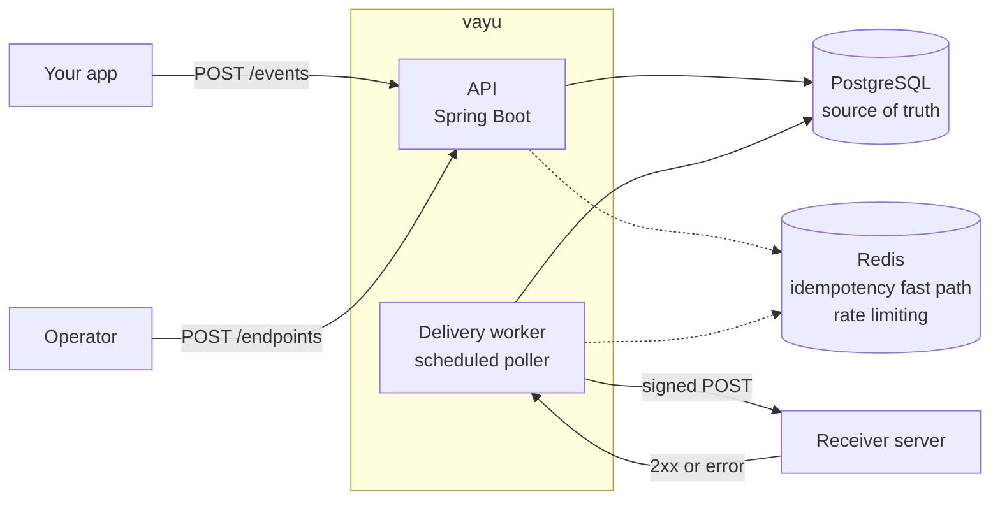
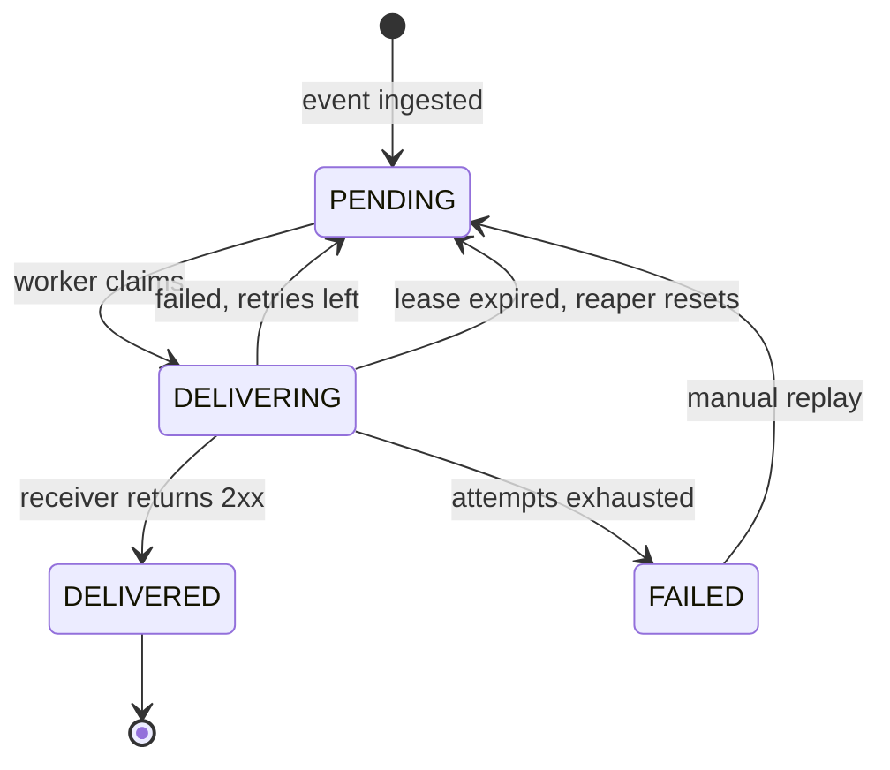

# vayu

A small webhook delivery service built with Spring Boot, PostgreSQL and Redis.

Your app tells vayu that something happened (a payment succeeded, an order shipped). Vayu makes sure every customer who subscribed gets told, with signed requests, retries and a full delivery log, even when their server is flaky.

## Why this exists

Sending one HTTP POST is easy. Sending it reliably is the hard part:

- The receiver is down for ten minutes. Do you lose the event?
- The receiver returns a 500 or hangs. When do you retry, and when do you give up?
- Retries cause duplicates. How does the receiver stay safe?
- Anyone can POST to a public URL. How does the receiver know it came from you?
- A customer says "I never got it". Can you show exactly what happened?

Vayu handles these so your app only has to say "this event happened".

## Architecture

- The API stores events and creates one delivery per subscribed endpoint, in a single transaction.
- The worker polls for due deliveries, sends them, and records every attempt.
- PostgreSQL is the source of truth. Redis only holds short-lived state that can be rebuilt.

## Delivery states

| State        | Meaning                                                    |
| ------------ | ---------------------------------------------------------- |
| `PENDING`    | Not tried yet, or failed and waiting for `next_attempt_at` |
| `DELIVERING` | A worker holds it right now (`locked_at` is set)           |
| `DELIVERED`  | The receiver returned a 2xx                                |
| `FAILED`     | All attempts used up. Needs a manual replay                |
