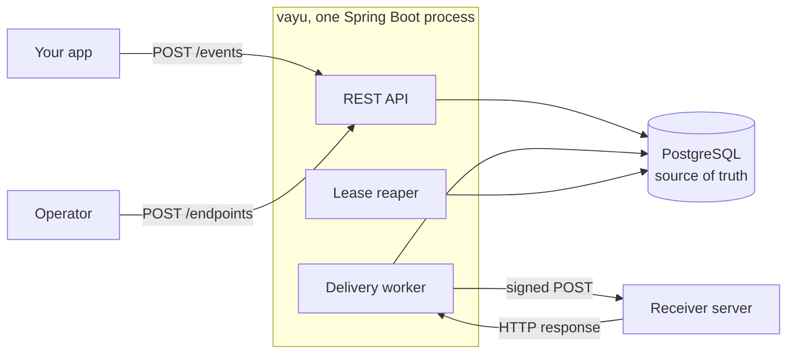
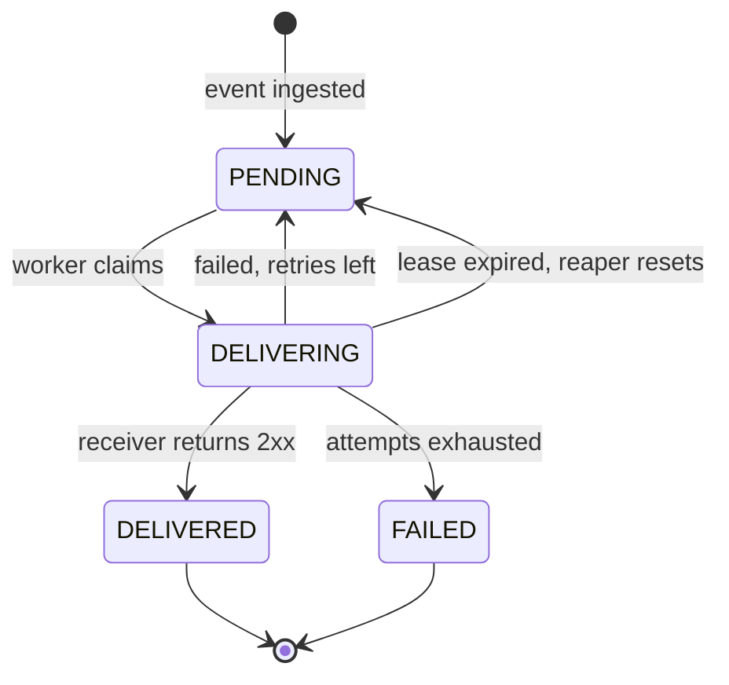

# vayu

[](https://github.com/md-talim/vayu/actions/workflows/ci.yml)
[](https://adoptium.net/)
[](https://spring.io/projects/spring-boot)
[](https://www.postgresql.org/)
[](LICENSE)

A small webhook delivery service built with Java 21, Spring Boot and PostgreSQL.

Your app tells vayu that something happened (a payment succeeded, an order shipped). Vayu sends a signed POST to every subscribed endpoint, retries failures, and records every attempt.

[How It Works](#how-it-works) • [Getting Started](#getting-started) • [API Docs](#api-documentation) • [Receiving Webhooks](#receiving-a-webhook) • [Retry Policy](#retry-policy) • [Configuration](#configuration)

## Why this exists

Sending one HTTP POST is easy. Sending it reliably is the hard part:

- The receiver is down for ten minutes. Do you lose the event?
- The receiver returns a 500 or hangs. When do you retry, and when do you give up?
- Retries cause duplicates. How does the receiver stay safe?
- Anyone can POST to a public URL. How does the receiver know it came from you?
- A customer says "I never got it". Can you show exactly what happened?

Vayu handles these so your app only has to say "this event happened".

## Architecture



- The API and worker run in the same Spring Boot process.
- PostgreSQL is the only stateful dependency.
- The scheduler claims work. HTTP calls normally run on a bounded executor.

## Delivery states



| State        | Meaning                                                    |
| ------------ | ---------------------------------------------------------- |
| `PENDING`    | Not tried yet, or failed and waiting for `next_attempt_at` |
| `DELIVERING` | Claimed by a worker; `locked_at` and `lock_token` are set  |
| `DELIVERED`  | The receiver returned a 2xx                                |
| `FAILED`     | Attempts are exhausted or the error is permanent           |

## How it works

1. Create an endpoint and subscribe it to one or more event types. Vayu returns a signing secret.
2. Send an event with an `Idempotency-Key`. Vayu stores it and creates one delivery per active subscription.
3. A scheduled worker claims due deliveries with `FOR UPDATE SKIP LOCKED`, signs the payload, and sends a POST.
4. A 2xx response marks the delivery delivered. Retryable errors are retried with exponential backoff and jitter. Other responses fail permanently.
5. A reaper returns deliveries with an expired lease to `PENDING`, so a crashed worker does not leave them stuck.
6. Query deliveries and attempts to see what happened.

## Getting started

### Run everything with Docker Compose

```bash
docker compose up --build
```

This starts PostgreSQL and the application. The API is available at `http://localhost:8080/api/v1`, and the health endpoint is at `http://localhost:8080/api/v1/actuator/health`.

The database uses a named volume, so data survives `docker compose down`. Use `docker compose down -v` if you also want to delete the data.

### Run the app locally

```bash
docker compose up -d db
./mvnw spring-boot:run
```

The application reads the default local database settings from `src/main/resources/application.yml`.

### Run the tests

```bash
./mvnw verify
```

The tests use Testcontainers, so Docker must be running. They do not use the Compose database.

### API documentation

Swagger UI: `http://localhost:8080/api/v1/swagger-ui.html`

OpenAPI JSON: `http://localhost:8080/api/v1/v3/api-docs`

The Bruno collection in [`bruno/vayu`](bruno/vayu) follows the main flow: create an endpoint, create an event, then inspect deliveries and attempts. It uses `http://localhost:8080/api/v1` as the base URL.

Swagger UI and the OpenAPI document are enabled by default. Set `springdoc.api-docs.enabled=false` and `springdoc.swagger-ui.enabled=false` to disable them.

## Quick example

Create an endpoint. The response includes the signing secret.

```bash
curl -sS -X POST http://localhost:8080/api/v1/endpoints \
  -H 'Content-Type: application/json' \
  -d '{"url":"http://localhost:9090/webhook","eventTypes":["payment.succeeded"]}'
```

If vayu runs in Docker and the receiver runs on your host, use `http://host.docker.internal:9090/webhook` instead. The Compose file adds the `host.docker.internal` host mapping on Linux.

Send an event. The `payload` field is a JSON string, not a JSON object.

```bash
curl -sS -X POST http://localhost:8080/api/v1/events \
  -H 'Content-Type: application/json' \
  -H 'Idempotency-Key: evt-001' \
  -d '{"type":"payment.succeeded","payload":"{\"amount\":100,\"currency\":\"USD\"}"}'
```

Reusing the same key with the same event returns `200` and `Idempotency-Replayed: true`. Reusing it with a different event returns `409`.

List deliveries for the endpoint:

```bash
curl -sS 'http://localhost:8080/api/v1/deliveries?endpointId=<endpoint-id>'
```

Inspect one delivery and its attempts:

```bash
curl -sS http://localhost:8080/api/v1/deliveries/<delivery-id>
```

## Receiving a webhook

Vayu sends the stored event payload as the request body with these headers. Payloads are stored as `jsonb`, so whitespace and key order may differ from what you submitted.

| Header               | Meaning                             |
| -------------------- | ----------------------------------- |
| `X-Vayu-Event-Id`    | Event UUID. Use this to deduplicate |
| `X-Vayu-Event-Type`  | Event type                          |
| `X-Vayu-Delivery-Id` | Delivery UUID                       |
| `X-Vayu-Attempt`     | Attempt number, starting at 1       |
| `X-Vayu-Timestamp`   | Unix timestamp in seconds           |
| `X-Vayu-Signature`   | `v1=<hex HMAC-SHA256 signature>`    |

The signature is computed over the timestamp and the exact request body:

```text
signed = timestamp + "." + rawBody
signature = hex(HMAC-SHA256(secret, signed))
```

Use the endpoint secret from the create response and compare the signature in constant time. Do not re-serialize the body before verifying it.

Receivers should:

- Return a 2xx after storing the event.
- Deduplicate by `X-Vayu-Event-Id`. Delivery is at least once.
- Return `408`, `425`, `429` or a `5xx` when they want vayu to retry.
- Return another `4xx` for permanent failures.
- Honor `Retry-After` when returning `429` or `503`.

## Retry policy

- `2xx`: delivered.
- `408`, `425`, `429`, `5xx`, timeouts and connection errors: retry.
- Other `3xx` and `4xx` responses: permanent failure.
- An endpoint that is deactivated before sending: failure without an HTTP call.
- Backoff: `min(maxDelay, baseDelay * multiplier^(attempt - 1))`, followed by full jitter.
- `Retry-After` is honored, capped by `maxDelay`.
- The default maximum is 10 attempts.

## Background worker

The worker is embedded in the application. There is no separate worker process.

- `WorkerConfig` enables Spring scheduling and creates the bounded `deliveryExecutor`.
- `DeliveryPoller` has a `@Scheduled` method that runs every `vayu.worker.poll-interval` (default `1s`) and calls `DeliveryWorker.runOnce()`.
- `DeliveryReaperTrigger` has a `@Scheduled` method that runs every `vayu.worker.reaper.interval` (default `30s`).
- Spring registers both scheduled methods after the application context starts.
- `fixedDelay` means the next run starts after the previous one finishes. The scheduler has two threads, so the poller and reaper do not block each other.
- The poller claims a batch and submits each delivery to the executor. HTTP calls normally happen on `delivery-*` threads. If the executor is saturated, `CallerRunsPolicy` can run one on the polling thread.
- Set `vayu.worker.enabled=false` to run the API without background delivery.

The reaper looks for `DELIVERING` rows whose lease has expired. It completes the open attempt with `lease expired`, then either schedules a retry or marks the delivery failed. A late completion from the old worker is rejected by the lock token.

## Configuration

The defaults are in `src/main/resources/application.yml`.

| Property                      | Default | Meaning                              |
| ----------------------------- | ------- | ------------------------------------ |
| `vayu.worker.enabled`         | `true`  | Enables the poller and reaper        |
| `vayu.worker.poll-interval`   | `1s`    | Delay between claim rounds           |
| `vayu.worker.batch-size`      | `4`     | Deliveries claimed per round         |
| `vayu.worker.concurrency`     | `4`     | HTTP worker threads                  |
| `vayu.worker.queue-capacity`  | `4`     | Executor queue size                  |
| `vayu.worker.lease`           | `60s`   | Time before a delivery can be reaped |
| `vayu.worker.reaper.interval` | `30s`   | Delay between reaper runs            |
| `vayu.worker.retry.*`         |         | Base delay, max delay and multiplier |

Keep the lease longer than the maximum time a claimed delivery can wait in the executor queue.

## Current scope

- No dashboard or UI.
- No manual replay yet.
- Endpoint secrets are stored as plaintext because vayu needs them to compute signatures.
- Delivery is at least once, so receivers must deduplicate.
- The API is not authenticated yet.
